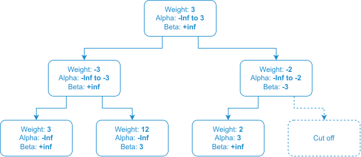
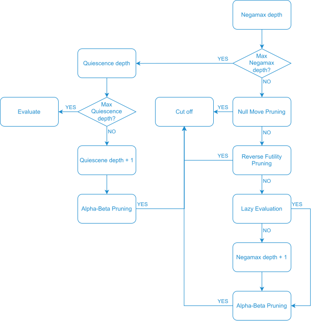

# Algorithm

The search is fundamentally based on **Negamax** with **Alpha-Beta Pruning**.

The search further incorporates **Null Move Pruning**, **Reverse Futility Pruning**, **Lazy Evaluation** and **Quiescence**.

Instead of searching to a fixed depth, the algorithm uses **Iterative Deepening** with **PV-Move** and **Aspiration Windows**.
